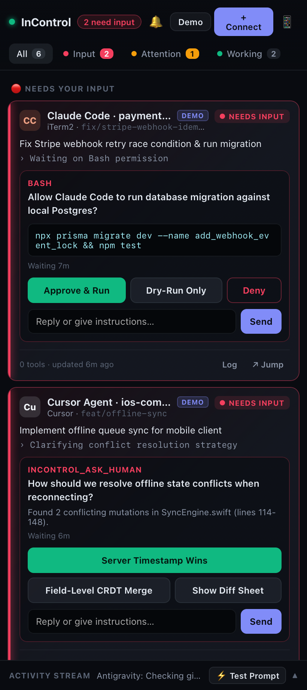

<p align="center">
  
</p>

<h1 align="center">InControl</h1>

<p align="center">
  <a href="https://github.com/IoannisZempe/InControl/actions/workflows/ci.yml"></a>
  <a href="LICENSE"></a>
  <a href="CONTRIBUTING.md"></a>
</p>

**One always-on side panel for all your AI agents.** See which agents need your input, which need your attention, and which are fine. Works across IDEs and terminals, and shows up on your Mac, phone, and any browser.

<p align="center">
  
</p>

```
🔴 Needs input      Claude Code · payments-service   "Allow prisma migrate?"  [Approve] [Deny] [reply…]
🟠 Needs attention  Codex CLI · cloud-infra           "Done: terraform plan is ready for review"
🟢 Working          Antigravity · InControl           › editing src/server/hub.js
⚪ Idle             EvalRunner · llm-eval-suite
```

## Features

- **Triage view.** Agents are sorted into four groups: *Needs input → Needs attention → Working → Idle*.
- **Zero-config auto-discovery.** Automatically detects live **Antigravity**, **ChatGPT Desktop (`ChatGPT.app`)**, and **OpenAI Codex** sessions on your Mac with zero manual wrapping.
- **Two-way remote control.** Approve, deny, stop, or type a steering reply from the side panel or your phone:
  - **Antigravity:** Native `PreInvocation`, `PreToolUse`, `PostToolUse`, and `Stop` lifecycle hooks inject your panel/phone messages directly into the next model step (`injectSteps`) or auto-continue finished turns.
  - **ChatGPT Desktop & Codex:** Queues follow-up/steering prompts directly into active threads via `codex queue --thread <id> --message <text>` and MCP tools.
  - **Claude Code & Cursor:** Native lifecycle hooks (`~/.claude/settings.json`) and stdio MCP server.
- **WhatsApp auto-escalation.** If an agent is waiting in *Needs Input* and you don't respond within your chosen timeout (`30s`–`5m`), InControl automatically sends the prompt and a 1-tap mobile link to your WhatsApp (via CallMeBot, Twilio two-way webhook, Meta Cloud API, or custom webhook).
- **Jump to window.** On macOS, one click brings the right IDE (`Antigravity`, `ChatGPT`, `Cursor`, `VS Code`) or terminal window (`iTerm2`, `Ghostty`, `Warp`, `Terminal`) to the front.
- **Custom 1-click functions & macros.** Add your own reusable functions (agent prompts, workspace commands like `git status -sb` or `npm test`, or webhooks) directly to every agent card.
- **Apple Liquid Glass macOS side panel.** A native Cocoa `NSPanel` + `NSVisualEffectView` floating panel with customizable glass themes (*Liquid Obsidian*, *Midnight Sapphire*, *Graphite Titanium*), selectable brand logo marks (*Command Orbit*, *HUD Reticle*, *Control Faders*), and smart auto-pop-up when an agent requires action.
- **Phone, tablet, and other devices.** Scan the QR code to open the panel over your LAN or Tailscale.
- **1-Click Daily Context Archive (Save Day -> Railway).** Click **Save Day** in the panel to capture the full day's InControl logs, touched Git repositories & commits, and local AI session summaries (Antigravity, Codex, Claude Code) with automatic secret redaction, archived by day into your own Railway PostgreSQL database:
  ```bash
  ./scripts/setup-railway.sh    # or: npx incontrol-agents setup railway
  ```
- **Local-first.** Everything runs on your machine. No cloud account needed.

## Quick start

```bash
npm install
npm start             # start the hub on http://localhost:4747
npm run panel         # open the native macOS side panel (compiles once with swiftc)
```

Then open http://localhost:4747 or scan the 📱 QR code with your phone.

## Connecting agents

| Agent | How | Command |
|---|---|---|
| **Claude Code** | Native hooks (`PreToolUse`, `Notification`, `Stop`, `UserPromptSubmit`) | `node bin/incontrol.js setup claude-code --install` |
| **Antigravity / Cursor / Windsurf / VS Code / Claude Desktop** | MCP server (stdio) | `node bin/incontrol.js setup mcp --ide Cursor` → paste into your MCP config |
| **Codex / Aider / OpenCode / Gemini CLI / any CLI** | Process wrapper that detects prompts and passes your replies to stdin | `incontrol wrap --name Codex -- codex` |
| **Custom agents** | REST API + JS/Python SDK | see below |

### Claude Code: approve Bash from your phone
Add `--gate-bash` to the `PreToolUse` hook command. Each Bash call then waits for your Approve or Deny in InControl. Deny blocks the call and sends your reason back to Claude.

### MCP tools for IDE agents (including cross-IDE context handoff)
- `incontrol_status`: report the current task and step
- `incontrol_ask_human`: wait for your decision or free-text answer
- `incontrol_check_inbox`: pick up instructions you sent from the panel
- `incontrol_list_context`: list today's live AI sessions (Antigravity, Codex, Claude Code), touched workspaces, handoffs, and archived Railway days
- `incontrol_get_context`: pull a portable, secret-redacted Markdown handoff brief from another agent, workspace, or archived Railway day into the current IDE
- `incontrol_save_handoff`: checkpoint this agent's goal, summary, and next steps so another IDE/agent can continue seamlessly

Tip: add a rule to your IDE agent such as *"Call `incontrol_status` when you start or finish a task, and use `incontrol_ask_human` instead of stopping when you need a decision."*

### Custom agents

```python
from python_sdk import InControlAgent      # src/sdk/python_sdk.py, no dependencies
agent = InControlAgent(name="DeployBot")
agent.working("Deploy staging", "kubectl apply")
decision = agent.ask_human("Promote to production?", ["Promote", "Abort"])
```

```js
import { InControlAgent } from './src/sdk/index.js';
const agent = new InControlAgent({ name: 'DeployBot' });
const { action, text } = await agent.askHuman('Promote to production?', ['Promote', 'Abort']);
```

Or call the HTTP API directly:

| Method | Path | Purpose |
|---|---|---|
| `POST` | `/api/agents/event` | Register or update an agent (`status`: `working` / `needs_attention` / `idle`). Returns any queued messages |
| `POST` | `/api/agents/ask` | Ask for input. With `wait: true` (the default), the request blocks until you answer |
| `GET` | `/api/agents/:id/messages` | Fetch instructions you sent from the panel |
| `POST` | `/api/agents/:id/respond` | Answer as the user (used by the UI) |
| `POST` | `/api/agents/:id/focus` | Bring the agent's IDE window to the front (macOS) |
| `GET` | `/api/state` | Full snapshot |
| `WS` | `/ws` | Real-time state updates |

## Architecture

```
 Agents (hooks / MCP / CLI wrapper / SDK)
          │  HTTP
          ▼
 ┌──────────────────────┐      WebSocket       ┌─────────────────────────────┐
 │  InControl Hub :4747 │ ───────────────────▶ │ macOS side panel (WKWebView)│
 │  state + attention   │ ◀─── replies ─────── │ Browser / Phone PWA         │
 └──────────────────────┘                      └─────────────────────────────┘
```

## Security & Device Pairing

- **Pairing-Token Auth for Phones & Remote Devices:** On first start, InControl generates a 192-bit cryptographic pairing token stored in `~/.incontrol/config.json` (`0600`).
- **One-Scan QR Pairing:** Scanning the 📱 QR code in the panel opens `http://<lan-ip>:4747/?token=...`, which exchanges the token for a long-lived `HttpOnly; SameSite=Strict` session cookie and strips the token from the URL.
- **Zero-Config Local Connectors:** Local agents and the macOS panel on `127.0.0.1` connect seamlessly without extra setup (or pass `--strict` to require the token on localhost too, or `--local-only` to disable LAN binding altogether).
- **Cross-Site & DNS Rebinding Protection:** The hub enforces strict `Host` allowlisting and `Origin` checks so external websites cannot talk to your local hub.
- Rotate your token anytime with `incontrol token --rotate`.

## Roadmap

- [x] Pairing token / QR auth for remote devices (#1)
- [ ] Web Push notifications for the PWA when it's in the background (#5)
- [ ] VS Code / JetBrains extension (status bar + webview)
- [ ] Persistent history (SQLite)
- [ ] Optional end-to-end encrypted relay for access outside your network

## Contributing

New connectors, SDKs and fixes are very welcome. See [CONTRIBUTING.md](CONTRIBUTING.md), the [Code of Conduct](CODE_OF_CONDUCT.md), and the [Security Policy](SECURITY.md).

## License

[MIT](LICENSE)
