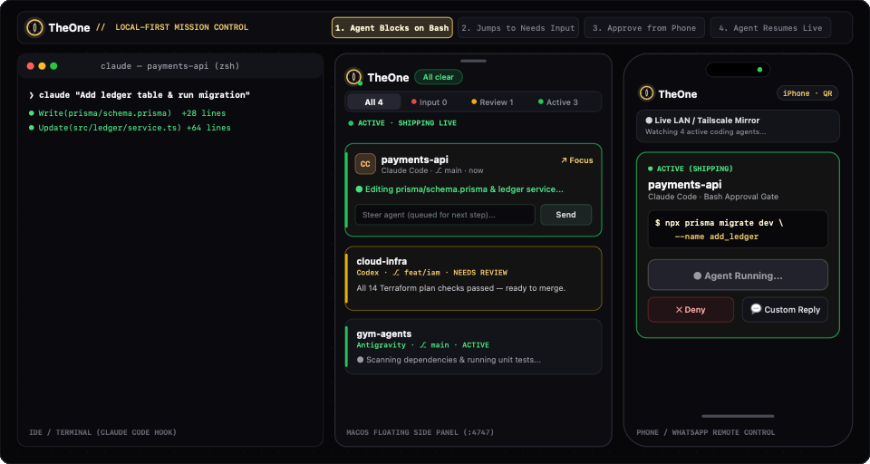

<p align="center">
  
</p>

<h1 align="center">TheOne</h1>

<p align="center">
  <strong>Local-first mission control for AI coding agents.</strong><br/>
  Triage every Claude Code, Codex, Antigravity, and Cursor session in one live panel.<br/>
  Walk away from your desk while an agent runs a migration, get a WhatsApp or phone ping when <code>--gate-bash</code> pauses a risky shell command, and tap <strong>Approve</strong> from your phone so it keeps shipping.
</p>

<p align="center">
  <a href="https://github.com/IoannisZempe/InControl/actions/workflows/ci.yml"></a>
  <a href="LICENSE"></a>
  
  
  =20" />
  <a href="CONTRIBUTING.md"></a>
  <a href="https://x.com/ioanniszempe"></a>
</p>

<p align="center">
   Card jumps to Needs Input -> Approved from phone -> Agent resumes" width="820" />
</p>

## 30-Second Quick Start

**1. Start the Local Hub + Web & Phone UI (`macOS`, `Linux`, `WSL` — Node >= 20):**

```bash
npx incontrol-agents start
```

**2. Optional Native macOS Floating Side Panel (`macOS` only — requires Xcode CLT):**

```bash
npx incontrol-agents start --panel   # Compiles & docks the native macOS side panel
npx incontrol-agents service install # Optional: auto-start Hub + macOS panel at login
```

Open `http://localhost:4747` on your machine, or scan the terminal QR code to control sessions from your phone over LAN or Tailscale.

### Platform Scope

| Surface / Capability | Platforms | Notes |
|---|---|---|
| **Hub (`:4747`) + Web & Phone PWA + QR Pairing** | **macOS, Linux, WSL** | Zero compiler dependencies (`Node >= 20`) |
| **Claude Code `--gate-bash` Hooks + Stdio MCP + CLI Wrapper** | **macOS, Linux, WSL** | Works in any terminal or IDE supporting MCP/hooks |
| **WhatsApp Escalation + Railway Daily Postgres Archive** | **macOS, Linux, WSL** | Outbound HTTPS / webhook sync with local secret redaction |
| **Floating Liquid Glass Side Panel & 1-Click Window Focus** | **macOS Native (`--panel`)** | Compiles `macos/InControlPanel.swift` (`Cocoa` + `WebKit`) |

---

## Why TheOne: Approve Risky Bash From Your Phone

Most agent dashboards are passive monitors that still force you to sit at your desk. **TheOne** is built for **asynchronous mobile steering**:

1. **Gate Risky Commands (`--gate-bash`):** Enable Claude Code's native `PreToolUse` hook with `--gate-bash`:
   ```bash
   npx incontrol-agents setup claude-code --install --gate-bash
   ```
2. **Instant Priority Triage & Escalation:** When an agent tries to run a shell command (like `npx prisma migrate dev` or `terraform apply`), execution pauses and the card jumps to the top **`Needs Input`** lane. If you don't respond within your configured window (e.g. 60s), **TheOne** pings your **WhatsApp** or phone with the exact command and a 1-tap deep link.
3. **Unblock From Anywhere:** Tap **Approve** (or **Deny** with feedback) from your phone or reply `1` / `2` on WhatsApp. The hook unblocks in milliseconds and your agent keeps shipping.

---

## Core Capabilities

### `01 // Attention Triage Engine`
Agents are sorted automatically into four live priority lanes so you never hunt through 12 terminal tabs:
`Needs Input` &rarr; `Needs Review` &rarr; `Active` &rarr; `Idle`.

### `02 // Two-Way Steering & Approvals`
Approve, deny, stop, or queue follow-up instructions inline from Mac or phone via native lifecycle hooks (`Claude Code`, `Antigravity`), `codex queue --thread`, process stdin wrapping (`incontrol wrap`), and stdio MCP (`incontrol_ask_human`).

### `03 // Zero-Config macOS Auto-Discovery`
On macOS, automatically detects active **Antigravity**, **ChatGPT Desktop (`ChatGPT.app`)**, and **OpenAI Codex** sessions with zero manual wrapping.

### `04 // Custom 1-Click Macros & IDE Window Focus`
Pin custom macro buttons (`Run Tests`, `Security Check`, custom prompts, or allowlisted shell commands) onto every agent card, or jump directly to the agent's window in `Antigravity`, `ChatGPT`, `Cursor`, `VS Code`, `Ghostty`, `iTerm2`, or `Warp` in one click.

### `05 // Phone QR Pairing + WhatsApp Escalation`
Scan the terminal QR code for instant LAN or Tailscale mobile access (192-bit token exchanged for an `HttpOnly; SameSite=Strict` session cookie). Unanswered prompts escalate to WhatsApp via CallMeBot, Twilio (2-way replies), Meta Cloud API, or custom webhooks.

### `06 // Auto Daily Archive & Cross-IDE Handoff`
Checkpoints structured events, Git commits, and secret-redacted AI session digests every **15 minutes** and at **midnight rollover** into local JSONL (`~/.incontrol/history/YYYY-MM-DD.jsonl`) and your private **Railway PostgreSQL** archive — portable across IDEs via MCP:

```bash
./scripts/setup-railway.sh    # or: npx incontrol-agents setup railway
```

---

## Architecture

<p align="center">
  
</p>

---

## Connecting Agents

| Agent | Integration | Setup Command |
|---|---|---|
| **Claude Code** | Native hooks (`PreToolUse`, `Notification`, `Stop`, `UserPromptSubmit`) | `incontrol setup claude-code --install --gate-bash` |
| **Antigravity** | Auto-discovered + plugin (`hooks.json`, MCP & steering rule) | `incontrol setup antigravity` |
| **Cursor / Windsurf / VS Code** | Stdio MCP server | `incontrol setup cursor` (or `incontrol setup mcp --ide VSCode`) |
| **ChatGPT Desktop & Codex** | Auto-discovered on macOS + `codex queue` + MCP | `incontrol setup codex` (or `incontrol wrap --name Codex -- codex`) |
| **Aider / OpenCode / Gemini CLI / any CLI** | Process wrapper piping replies straight to stdin | `incontrol wrap --name Gemini -- gemini` |
| **Custom Agents** | REST API, WebSocket, Node & Python SDKs | See [SDKs & API](#custom-agents--http-api) below |

---

## Cross-IDE Context & Daily Archive

TheOne continuously logs structured agent events to `~/.incontrol/history/YYYY-MM-DD.jsonl` and automatically snapshots & syncs changes every **15 minutes**, at **midnight day rollover**, and for any missed previous day — or click **Save Day** anytime for an instant checkpoint.

Secrets (PEM keys, `Bearer` tokens, JWTs, API key prefixes, and credentialed URLs) are redacted by `redactSecrets` before saving locally or pushing to Railway `daily_contexts`.

### MCP Tools (`incontrol-mcp`)
- `incontrol_status`: report current task, step, branch, and status
- `incontrol_ask_human`: pause until you approve/deny or reply from Mac, browser, or phone
- `incontrol_check_inbox`: pull queued steering messages sent from the panel
- `incontrol_list_context`: inspect today's live sessions (`Antigravity`, `Codex`, `Claude Code`), active repos, handoffs, and saved Railway days
- `incontrol_get_context`: export a portable, secret-redacted Markdown handoff brief for any project, workspace, or archived `YYYY-MM-DD` date
- `incontrol_save_handoff`: checkpoint an agent's goal, summary, and next steps so a different IDE/agent can pick up right where it left off

> Tip: add a rule to your IDE agent: *"Call `incontrol_status` when starting or finishing a task, `incontrol_ask_human` when blocked on a decision, and `incontrol_get_context` when resuming work across tools."*

---

## Custom Agents & HTTP API

<details>
<summary><strong>Python SDK, Node SDK, and Hub REST / WebSocket endpoints</strong></summary>

#### Python SDK (`src/sdk/python_sdk.py`, zero dependencies)
```python
from python_sdk import InControlAgent

agent = InControlAgent(name="DeployBot")
agent.working("Deploy staging", "kubectl apply")
decision = agent.ask_human("Promote to production?", ["Promote", "Abort"])
```

#### Node SDK (`src/sdk/index.js`)
```js
import { InControlAgent } from './src/sdk/index.js';

const agent = new InControlAgent({ name: 'DeployBot' });
const { action, text } = await agent.askHuman('Promote to production?', ['Promote', 'Abort']);
```

#### HTTP & WebSocket API (`:4747`)
| Method | Endpoint | Purpose |
|---|---|---|
| `POST` | `/api/agents/event` | Register or update an agent (`working`, `needs_attention`, `idle`); returns queued instructions |
| `POST` | `/api/agents/ask` | Request input (`wait: true` blocks until answered) |
| `GET` | `/api/agents/:id/messages` | Fetch queued messages from the panel |
| `POST` | `/api/agents/:id/respond` | Submit human approval or reply |
| `POST` | `/api/agents/:id/focus` | Focus the agent's IDE or terminal window (macOS) |
| `POST` | `/api/context/capture` | Snapshot & sync a day (`{ "day": "YYYY-MM-DD" }` optional) |
| `GET` | `/api/context/days` | List saved Railway + local days |
| `GET` | `/api/context/export` | Export portable Markdown handoff brief (`?day=...&project=...`) |
| `GET` | `/api/state` · `WS /ws` | Full live state snapshot and real-time updates |

</details>

---

## Security & Device Pairing

- **192-Bit Cryptographic Pairing Token:** Generated on first boot in `~/.incontrol/config.json` (`0600`). Rotate anytime via `incontrol token --rotate`.
- **One-Scan QR Sessions:** Opening `http://<lan-ip>:4747/?token=...` exchanges the token for a long-lived `HttpOnly; SameSite=Strict` cookie and strips the token from the URL.
- **Zero-Config Loopback / Hardened Flags:** Loopback agents connect seamlessly by default, or run `incontrol start --strict` (require token on localhost) or `incontrol start --local-only` (disable LAN binding).
- **Origin & Host Guard:** Enforces strict `Host` allowlisting and `Origin` validation with no permissive CORS to block cross-site and DNS-rebinding attacks.

---

## Roadmap

- [x] Pairing token & QR authentication for phones and LAN/Tailscale devices
- [x] Apple Liquid Glass native macOS floating side panel + Apple HomeView/HomeKit
- [x] Automatic 15-minute & rollover Daily Context Archive -> Railway PostgreSQL + cross-IDE MCP handoff
- [x] Web Push notifications for background PWA sessions (RFC 8291 `aes128gcm` + VAPID + Service Worker)
- [ ] Native VS Code / JetBrains status-bar extension
- [ ] Optional end-to-end encrypted relay outside your local network

---

## Contributing

New connectors, IDE integrations, SDK improvements, and fixes are always welcome. See [CONTRIBUTING.md](CONTRIBUTING.md), the [Code of Conduct](CODE_OF_CONDUCT.md), and the [Security Policy](SECURITY.md).

## License & Contact

**Source-Available — [FSL-1.1-MIT](LICENSE)** (Functional Source License, Version 1.1, MIT Future License) — Copyright © 2026 **Ioannis Zempekakis**.
Free for everyone to use, inspect, and modify for personal or internal business use; commercial resale or competing hosted products/services are restricted for 2 years before automatically converting to the permissive **MIT** license.

Questions, feedback, or commercial licensing inquiries:
- **X:** [@ioanniszempe](https://x.com/ioanniszempe)
- **Email:** [izempekakis@gmail.com](mailto:izempekakis@gmail.com)
- **GitHub:** [@IoannisZempe](https://github.com/IoannisZempe)
