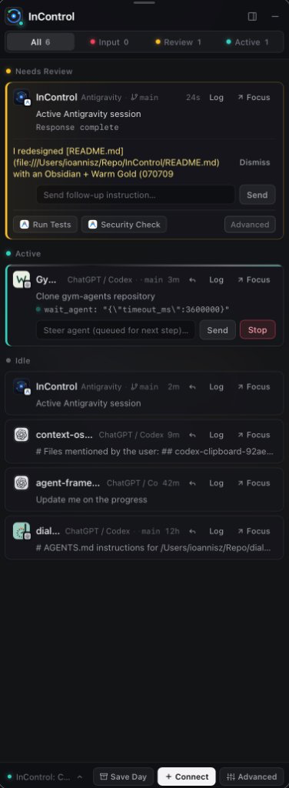
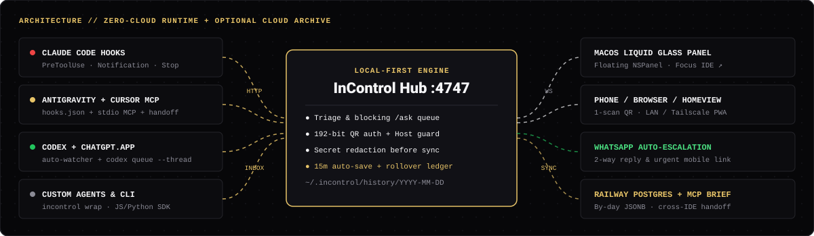

<p align="center">
  
</p>

<p align="center">
  <a href="https://github.com/IoannisZempe/InControl/actions/workflows/ci.yml"></a>
  <a href="LICENSE"></a>
  
  =20" />
  <a href="CONTRIBUTING.md"></a>
  <a href="https://x.com/ioanniszempe"></a>
</p>

<p align="center">
  <strong>One always-on side panel &amp; mobile control room for all your AI coding agents.</strong><br/>
  See who needs your input, who finished for review, and who is still shipping — across IDEs, terminals, your phone, and WhatsApp.
</p>

---

## Inside the Control Room

<table>
  <tr>
    <td width="310" valign="top" align="center">
      
    </td>
    <td valign="top">
      <strong><code>// QUICK START</code></strong>
      <pre lang="bash"># Option A: Global CLI or npx (Node &gt;= 20)
npm install -g incontrol-agents
incontrol start --panel          # Hub :4747 + native macOS side panel
incontrol service install        # Optional: auto-start hub + panel at login

# Option B: Try in one command or run from source
npx incontrol-agents start --panel
# or: git clone https://github.com/IoannisZempe/InControl.git &amp;&amp; cd InControl &amp;&amp; npm install &amp;&amp; npm start -- --panel</pre>
      <sub>First macOS panel launch compiles cleanly to <code>~/.incontrol/bin/incontrol-panel</code> (requires Xcode CLT). Open <code>http://localhost:4747</code> or scan the QR code from your phone.</sub>
      <br/><br/>
      <strong><code>01 // ATTENTION TRIAGE ENGINE</code></strong><br/>
      Agents are sorted automatically into four live priority lanes:<br/>
      <code>Needs Input</code> &rarr; <code>Needs Review</code> &rarr; <code>Active</code> &rarr; <code>Idle</code>.
      <br/><br/>
      <strong><code>02 // ZERO-CONFIG AUTO-DISCOVERY</code></strong><br/>
      Detects active <strong>Antigravity</strong>, <strong>ChatGPT Desktop (<code>ChatGPT.app</code>)</strong>, and <strong>OpenAI Codex</strong> sessions on macOS with zero manual wrapping.
      <br/><br/>
      <strong><code>03 // TWO-WAY STEERING &amp; APPROVALS</code></strong><br/>
      Approve, deny, stop, or reply inline from Mac or phone via native lifecycle hooks (<code>Claude Code</code>, <code>Antigravity</code>), <code>codex queue --thread</code>, and stdio MCP.
      <br/><br/>
      <strong><code>04 // CUSTOM MACROS &amp; JUMP TO WINDOW</code></strong><br/>
      Pin 1-click buttons (<code>Run Tests</code>, <code>Security Check</code>, custom prompts, or shell scripts) onto every card, or focus <code>Antigravity</code>, <code>ChatGPT</code>, <code>Cursor</code>, <code>VS Code</code>, <code>Ghostty</code>, <code>iTerm2</code>, or <code>Warp</code> in one click.
      <br/><br/>
      <strong><code>05 // PHONE QR + WHATSAPP ESCALATION</code></strong><br/>
      Scan the QR code for LAN/Tailscale mobile access. Unanswered prompts escalate to WhatsApp (CallMeBot, Twilio, Meta Cloud API, or webhook) with a 1-tap link.
      <br/><br/>
      <strong><code>06 // AUTO DAILY ARCHIVE &amp; HANDOFF</code></strong><br/>
      Checkpoints logs, Git commits, and redacted AI session digests every 15 minutes + midnight rollover into Railway PostgreSQL, portable across IDEs via MCP.
    </td>
  </tr>
</table>

To provision your private **by-day Railway PostgreSQL archive** automatically:

```bash
./scripts/setup-railway.sh    # or: npx incontrol-agents setup railway
```

---

## Architecture

<p align="center">
  
</p>

---

## Connecting Agents

| Agent | Integration | Setup Command |
|---|---|---|
| **Claude Code** | Native hooks (`PreToolUse`, `Notification`, `Stop`, `UserPromptSubmit`) | `incontrol setup claude-code --install` |
| **Antigravity** | Auto-discovered + plugin (`hooks.json`, MCP & steering rule) | `incontrol setup antigravity` |
| **Cursor / Windsurf / VS Code** | Stdio MCP server | `incontrol setup cursor` (or `incontrol setup mcp --ide VSCode`) |
| **ChatGPT Desktop & Codex** | Auto-discovered on macOS + `codex queue` + MCP | `incontrol setup codex` (or `incontrol wrap --name Codex -- codex`) |
| **Aider / OpenCode / Gemini CLI / any CLI** | Process wrapper piping replies straight to stdin | `incontrol wrap --name Gemini -- gemini` |
| **Custom Agents** | REST API, WebSocket, Node & Python SDKs | See [SDKs & API](#custom-agents--http-api) below |

### Claude Code: Approve Bash From Your Phone
Add `--gate-bash` to your `PreToolUse` hook command. Every Bash invocation pauses for your **Approve** or **Deny** tap in InControl; denying blocks execution and returns your explanation directly to Claude.

---

## Cross-IDE Context & Daily Archive

InControl continuously logs structured agent events to `~/.incontrol/history/YYYY-MM-DD.jsonl` and automatically snapshots & syncs changes every **15 minutes**, at **midnight day rollover**, and for any missed previous day — or click **Save Day** anytime for an instant checkpoint.

Secrets (PEM keys, `Bearer` tokens, JWTs, API key prefixes, and credentialed URLs) are redacted by `redactSecrets` before saving locally or pushing to Railway `daily_contexts`.

### MCP Tools (`incontrol-mcp`)
- `incontrol_status`: report current task, step, branch, and status
- `incontrol_ask_human`: pause until you approve/deny or reply from Mac, browser, or phone
- `incontrol_check_inbox`: pull queued steering messages sent from the panel
- `incontrol_list_context`: inspect today's live sessions (`Antigravity`, `Codex`, `Claude Code`), active repos, handoffs, and saved Railway days
- `incontrol_get_context`: export a portable, secret-redacted Markdown handoff brief for any project, workspace, or archived `YYYY-MM-DD` date
- `incontrol_save_handoff`: checkpoint an agent's goal, summary, and next steps so a different IDE/agent can pick up right where it left off

> Tip: add a rule to your IDE agent: *"Call `incontrol_status` when starting or finishing a task, `incontrol_ask_human` when blocked on a decision, and `incontrol_get_context` when resuming work across tools."*

---

## Custom Agents & HTTP API

<details>
<summary><strong>Python SDK, Node SDK, and Hub REST / WebSocket endpoints</strong></summary>

#### Python SDK (`src/sdk/python_sdk.py`, zero dependencies)
```python
from python_sdk import InControlAgent

agent = InControlAgent(name="DeployBot")
agent.working("Deploy staging", "kubectl apply")
decision = agent.ask_human("Promote to production?", ["Promote", "Abort"])
```

#### Node SDK (`src/sdk/index.js`)
```js
import { InControlAgent } from './src/sdk/index.js';

const agent = new InControlAgent({ name: 'DeployBot' });
const { action, text } = await agent.askHuman('Promote to production?', ['Promote', 'Abort']);
```

#### HTTP & WebSocket API (`:4747`)
| Method | Endpoint | Purpose |
|---|---|---|
| `POST` | `/api/agents/event` | Register or update an agent (`working`, `needs_attention`, `idle`); returns queued instructions |
| `POST` | `/api/agents/ask` | Request input (`wait: true` blocks until answered) |
| `GET` | `/api/agents/:id/messages` | Fetch queued messages from the panel |
| `POST` | `/api/agents/:id/respond` | Submit human approval or reply |
| `POST` | `/api/agents/:id/focus` | Focus the agent's IDE or terminal window (macOS) |
| `POST` | `/api/context/capture` | Snapshot & sync a day (`{ "day": "YYYY-MM-DD" }` optional) |
| `GET` | `/api/context/days` | List saved Railway + local days |
| `GET` | `/api/context/export` | Export portable Markdown handoff brief (`?day=...&project=...`) |
| `GET` | `/api/state` · `WS /ws` | Full live state snapshot and real-time updates |

</details>

---

## Security & Device Pairing

- **192-Bit Cryptographic Pairing Token:** Generated on first boot in `~/.incontrol/config.json` (`0600`). Rotate anytime via `incontrol token --rotate`.
- **One-Scan QR Sessions:** Opening `http://<lan-ip>:4747/?token=...` exchanges the token for a long-lived `HttpOnly; SameSite=Strict` cookie and strips the token from the URL.
- **Zero-Config Loopback / Hardened Flags:** Loopback agents connect seamlessly by default, or run `incontrol start --strict` (require token on localhost) or `incontrol start --local-only` (disable LAN binding).
- **Origin & Host Guard:** Enforces strict `Host` allowlisting and `Origin` validation with no permissive CORS to block cross-site and DNS-rebinding attacks.

---

## Roadmap

- [x] Pairing token & QR authentication for phones and LAN/Tailscale devices
- [x] Apple Liquid Glass native macOS floating side panel + Apple HomeView/HomeKit
- [x] Automatic 15-minute & rollover Daily Context Archive -> Railway PostgreSQL + cross-IDE MCP handoff
- [ ] Web Push notifications for background PWA sessions
- [ ] Native VS Code / JetBrains status-bar extension
- [ ] Optional end-to-end encrypted relay outside your local network

---

## Contributing

New connectors, IDE integrations, SDK improvements, and fixes are always welcome. See [CONTRIBUTING.md](CONTRIBUTING.md), the [Code of Conduct](CODE_OF_CONDUCT.md), and the [Security Policy](SECURITY.md).

## License & Contact

**[FSL-1.1-MIT](LICENSE)** — Copyright © 2026 **Ioannis Zempekakis**.
Free for everyone to use, inspect, and modify for personal or internal business use; commercial resale or competing products/services are restricted for 2 years before automatically converting to MIT.

Questions, feedback, or commercial licensing inquiries:
- **X:** [@ioanniszempe](https://x.com/ioanniszempe)
- **Email:** [izempekakis@gmail.com](mailto:izempekakis@gmail.com)
- **GitHub:** [@IoannisZempe](https://github.com/IoannisZempe)
